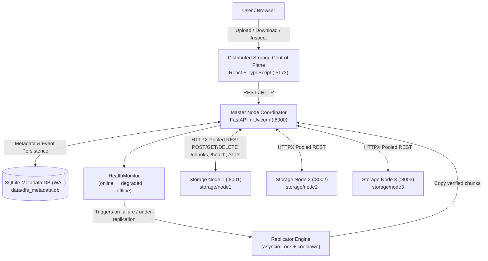

# Distributed File System with Fault Tolerance

**A fault-tolerant distributed object storage system featuring a central FastAPI Master Coordinator, independent Storage Node servers, Round-Robin chunk placement, configurable replication, SHA-256 integrity verification, automatic failure recovery, and a dark-themed React + TypeScript Control Plane.**


### Project Highlights

- **Decoupled Master–Worker Architecture:** Independent HTTP Storage Nodes coordinated by a persistent SQLite-backed Master Node.
- **Verified Data Integrity:** Per-chunk and full-file SHA-256 verification across uploads, active integrity probes, and reassembly.
- **Automated Fault Tolerance:** Health monitoring (`online → degraded → offline`), transparent replica failover on read, and locked background re-replication.
- **Engineering Control Plane:** Real-time React + TypeScript + Recharts console for cluster telemetry, chunk topology, node inspection, and event auditing.

---

## Table of Contents

1. [Overview](#overview)
2. [Key Features](#key-features)
3. [Architecture](#architecture)
4. [Architecture Diagram](#architecture-diagram)
5. [Technology Stack](#technology-stack)
6. [Technology Integration](#technology-integration)
7. [Project Structure](#project-structure)
8. [Installation (Windows)](#installation-windows)
9. [Running the Project](#running-the-project)
10. [Dashboard Features](#dashboard-features)
11. [API Documentation](#api-documentation)
12. [File Storage Workflow](#file-storage-workflow)
13. [Fault Tolerance](#fault-tolerance)
14. [Testing](#testing)
15. [Screenshots](#screenshots)
16. [Limitations](#limitations)
17. [Future Improvements](#future-improvements)
18. [License](#license)
19. [Author](#author)

---

## Overview

A **Distributed File System (DFS)** stores files across multiple independent storage servers rather than relying on a single machine's local disk. When a file is uploaded, it is partitioned into fixed-size chunks, distributed across storage nodes, and replicated so that individual node failures or chunk corruption do not cause data loss.

This project was built as an engineering-grade distributed storage prototype demonstrating:
- **Decoupled Control & Data Nodes:** A central **Master Node** manages cluster metadata, node health, chunk allocation, and recovery orchestration, while independent **Storage Nodes** persist raw chunk binaries and sidecar checksum metadata on local directories.
- **Data Integrity:** End-to-end SHA-256 checksums verify every chunk upon upload, during active integrity probes, and on reconstruction/download.
- **Automatic Fault Handling:** Periodic health monitoring detects degraded and offline nodes, file downloads automatically fail over to healthy replicas if a node is unreachable or corrupted, and an automated re-replication engine repairs under-replicated chunks onto healthy nodes.

---

## Key Features

- **Configurable File Chunking:** Splits binary and text files (`.txt`, `.pdf`, `.png`, `.zip`, etc.) into fixed-size chunks (`1 MiB` default, configurable via `/settings`) with deterministic chunk IDs (`<file_id>_c<index>`).
- **Round-Robin Distribution:** `RoundRobinDistributor` balances primary chunk placement across `online` nodes in sorted `node_id` order.
- **Distinct-Node Replication:** Configurable replication factor (default `2`), placing primary and replica copies on distinct nodes and enforcing uniqueness at both allocation and database schema levels (`UNIQUE(chunk_id, node_id)`).
- **SHA-256 Integrity Verification:** Computes full-file and per-chunk SHA-256 hashes; Storage Nodes reject mismatched uploads (`400 Bad Request`) and Master detects corrupted chunks during downloads and active integrity probes.
- **Node Health Monitoring:** Background `HealthMonitor` polls `GET /health` and `GET /stats` on registered nodes with startup grace delay, transient retry, `online` → `degraded` → `offline` state transitions, and atomic SQLite updates.
- **Replica Failover & Re-Replication:** Downloads transparently fail over to healthy replicas when a node is offline or corrupted; `Replicator` (guarded by an `asyncio.Lock` and failure cooldown) copies under-replicated chunks to healthy online nodes.
- **Persistent SQLite Metadata (WAL Mode):** Persists registered nodes, files, chunks, replica locations, runtime settings, and `system_events` across Master Node restarts.
- **Distributed Storage Control Plane UI:** Dark-themed React + TypeScript dashboard with Cluster Overview, Files & File Details topology, Storage Nodes inspector, Replication console, Monitoring, Event Logs, and Settings.
- **Security Controls:** Filename sanitization against path traversal, strict chunk ID regex validation (`^[A-Za-z0-9_-]{1,128}$`), base-directory containment checks, atomic temp-file writes (`os.replace`), and configurable upload size caps.

---

## Architecture

- **Master Node (`master/`):** FastAPI coordinator running on `127.0.0.1:8000`. Maintains SQLite metadata (`data/dfs_metadata.db`), schedules Round-Robin chunk placement, communicates with Storage Nodes via pooled `httpx.AsyncClient` requests, runs `HealthMonitor` and `Replicator`, and serves REST APIs for the dashboard.
- **Storage Nodes (`storage_node/`):** Independent FastAPI processes (defaults on ports `8001`, `8002`, `8003`) backed by isolated directories (`storage/node1`, `storage/node2`, `storage/node3`). Each node writes `.bin` chunk files and `.meta.json` checksum metadata atomically, serves chunk reads/deletes, reports disk stats, and auto-registers with the Master Node on startup.
- **Metadata Database (`master/database/db.py`):** Thread-safe SQLite repository using WAL journaling and foreign keys with tables `storage_nodes`, `files`, `chunks`, `chunk_locations`, `system_events`, and `settings`.
- **Frontend Control Plane (`frontend/`):** React 18 + TypeScript + Vite + Tailwind CSS v4 + Recharts + Lucide Icons console polling the Master Node REST API every 5 seconds.

---

## Architecture Diagram



---

## Technology Stack

### Backend Technologies


- **Python (`3.11+`):** Core backend runtime powering both the Master Coordinator and Storage Node services (`asyncio`, `hashlib`, `sqlite3`, `shutil`, `pathlib`).
- **FastAPI (`0.115.6`):** REST API framework exposing Master Coordinator (`/upload`, `/files`, `/nodes`, `/stats`, `/system/events`, `/settings`) and Storage Node (`/chunks`, `/health`, `/stats`) endpoints with OpenAPI/Swagger docs.
- **Uvicorn (`0.34.0`):** ASGI server hosting the Master Node (`:8000`) and each independent Storage Node (`:8001`–`:8003`).
- **HTTPX (`0.28.1`):** Pooled async HTTP client (`NodeClient`) used by the Master Node for chunk uploads/downloads/deletes and health probes with timeouts and retries.
- **Pydantic (`2.10.4`) & Pydantic Settings (`2.7.1`):** Strict request/response validation and environment-based configuration (`MasterSettings`, `StorageNodeSettings`).
- **Python-Multipart (`0.0.20`):** Multipart form parsing for file and chunk uploads.
- **SQLite3 (WAL Mode):** Persistent metadata engine (`data/dfs_metadata.db`) storing nodes, files, chunks, replica locations, settings, and `system_events`.
- **SHA-256 (`hashlib.sha256`):** End-to-end cryptographic checksums verifying full files and individual chunks on upload, download, and active integrity probes.

### Frontend Technologies


- **React (`18.3.1`):** Component-based UI framework driving the Distributed Storage Control Plane SPA.
- **TypeScript (`~5.6.2`):** Static type safety across API contracts (`src/types/dfs.ts`), reusable UI components, and pages.
- **Vite (`6.0.5`):** Fast local dev server (`:5173`) and production bundler (`tsc -b && vite build`).
- **Tailwind CSS (`4.0.0`):** Utility-first styling (`@tailwindcss/vite`) powering the dark infrastructure-console layout.
- **Lucide React (`0.469.0`):** Consistent iconography across navigation, status indicators, and actions.
- **Recharts (`2.15.0`):** Responsive bar visualizations for primary/replica chunk distribution, probe latency, and recorded event counts.

### Distributed Storage Technologies & Concepts

- **Master–Worker Architecture:** Central coordinator (`master/app.py`) decoupled from independent worker processes (`storage_node/app.py`).
- **File Chunking & Deterministic IDs:** `split_file_into_chunks()` slices payloads into configurable chunks (`<file_id>_c<index:05d>`) and `reconstruct_chunks()` reassembles them in exact order.
- **Round-Robin Distribution:** `RoundRobinDistributor` balances primary chunk placement across sorted `online` Storage Nodes.
- **Distinct-Node Replication:** Enforces configurable replication factor (default `2`) across distinct nodes via both placement logic and `UNIQUE(chunk_id, node_id)` in SQLite.
- **Health Monitoring & Failure Detection:** `HealthMonitor` polls nodes with a `5s` startup grace delay and 1 transient retry, transitioning nodes cleanly across `online` → `degraded` → `offline` (`3` consecutive misses).
- **Replica Failover & Re-Replication:** `FileService.download_file()` fails over automatically to healthy replicas when a node is unreachable or returns corrupted bytes; `Replicator` (guarded by `asyncio.Lock` and a `60s` cooldown) copies under-replicated chunks to healthy nodes.

### Development & Testing Tools


- **Pytest (`8.3.4`) & Pytest-Asyncio (`0.25.0`):** Automated unit and live multi-node HTTP integration test suite (`tests/`).
- **PowerShell:** Windows cluster launch and shutdown orchestration (`scripts/start_cluster.ps1`, `scripts/stop_cluster.ps1`).
- **npm & Vite Build Tools:** Frontend dependency management, TypeScript checking (`tsc -b`), and bundling.
- **Git & GitHub:** Version control and source hosting.

### Technology Summary

| Layer | Technology | Purpose |
|---|---|---|
| **Backend** | Python 3.11+, FastAPI, Uvicorn, HTTPX, Pydantic | Master coordinator REST APIs, chunking, Round-Robin placement, health checks, and async node communication |
| **Frontend** | React 18, TypeScript, Vite, Tailwind CSS v4, Lucide React, Recharts | Distributed Storage Control Plane dashboard, XHR upload progress, charts, and topology views |
| **Metadata** | SQLite3 (WAL mode) | Persistent storage for registered nodes, file/chunk metadata, replica locations, settings, and `system_events` |
| **Storage** | FastAPI Storage Nodes (`ChunkStore` + `os.replace`) | Independent node servers persisting `.bin` chunk payloads and `.meta.json` sidecars atomically on local disk |
| **Integrity** | SHA-256 (`hashlib.sha256`) | Per-chunk and full-file checksum verification during upload, active integrity probes, and reconstruction |
| **Testing** | Pytest, Pytest-Asyncio | Automated unit and live multi-server integration tests covering failover, corruption detection, and restarts |
| **Build** | npm, Vite (`6.0.5`), TypeScript (`tsc -b`) | Frontend compilation, type checking, and production asset bundling |

---

## Technology Integration

- **Coordinator & API Exposure:** **FastAPI** and **Uvicorn** serve the Master Node (`127.0.0.1:8000`) and each Storage Node (`:8001`–`:8003`). Incoming uploads hit `POST /upload`, where `FileService` validates filenames/sizes, computes full-file SHA-256, and splits data into chunks.
- **Chunk Placement & Storage Node Persistence:** `RoundRobinDistributor` picks distinct `online` nodes for each chunk's primary and replicas. **HTTPX** (`NodeClient`) transfers chunks via `POST /chunks`, and each Storage Node's `ChunkStore` verifies the SHA-256 hash and writes `<chunk_id>.bin` + `<chunk_id>.meta.json` atomically.
- **Metadata & Replica Management:** `MetadataDB` commits file, chunk, and `chunk_locations` rows in **SQLite** (WAL mode). `HealthMonitor` polls nodes periodically, while `Replicator` queries `get_under_replicated_chunks()` and copies verified bytes from healthy nodes to available `online` nodes when nodes go offline.
- **Dashboard Communication:** The **React + TypeScript** Control Plane (`src/services/api.ts`) polls `/health`, `/stats`, `/nodes`, `/files`, and `/system/events` every `5s`, uses `XMLHttpRequest` for real upload progress, and renders node health, primary/replica distribution, and audit logs with **Recharts** and **Lucide React**.
- **System Validation:** **Pytest** spins up temporary directories and real Uvicorn Storage Node + Master instances (`tests/test_integration.py`) to verify chunking, replication, failover, corruption detection, Master restart persistence, and deletion end-to-end.

---

## Project Structure

```text
Distributed-File-System-with-Fault-Tolerance/
├── master/                         # Central Master Node coordinator
│   ├── app.py                      # FastAPI app factory & lifespan startup/shutdown
│   ├── config.py                   # Pydantic settings (ports, timeouts, thresholds)
│   ├── database/db.py              # Thread-safe SQLite metadata & event persistence
│   ├── models/schemas.py           # Pydantic API request/response schemas
│   ├── monitoring/health_monitor.py# Periodic node liveness & transition monitor
│   ├── replication/replicator.py   # Automated under-replicated chunk recovery
│   ├── routes/                     # REST routers (files.py, nodes.py, system.py)
│   ├── services/                   # Chunker, RoundRobinDistributor, NodeClient, FileService
│   └── utils/security.py           # Filename sanitization, ID & URL validation
├── storage_node/                   # Independent Storage Node server
│   ├── app.py                      # FastAPI app factory & master auto-registration
│   ├── config.py                   # Node ID, port, storage directory & master URL config
│   ├── models.py                   # Storage Node response models
│   ├── routes/                     # /health, /stats, /chunks CRUD endpoints
│   ├── storage/chunk_store.py      # Atomic disk storage & SHA-256 verification
│   └── utils/security.py           # Chunk ID regex & path containment enforcement
├── frontend/                       # React + TypeScript Control Plane UI
│   ├── src/components/             # Sidebar, DataTable, MetricSummary, EventTimeline, etc.
│   ├── src/pages/                  # Overview, Files, FileDetails, Nodes, Replication, Monitoring, Events, Settings
│   ├── src/services/api.ts         # REST & XHR upload client
│   ├── src/types/dfs.ts            # TypeScript interfaces aligned with Master schemas
│   └── src/utils/format.ts         # Byte, timestamp, uptime & hash formatters
├── tests/                          # Unit & multi-node integration tests
├── storage/                        # Local directories for node1, node2, node3
├── data/                           # SQLite metadata database directory
├── documentation/                  # Detailed architecture notes (ARCHITECTURE.md)
├── screenshots/                    # Screenshot placeholders & capture guide
├── scripts/                        # Windows PowerShell start_cluster.ps1 / stop_cluster.ps1
├── .env.example                    # Example environment configuration
├── .gitignore
└── requirements.txt                # Pinned Python dependencies
```

---

## Installation (Windows)

**Prerequisites:** Python 3.11+ and Node.js 18+ (with `npm`).

1. **Clone the repository:**
   ```powershell
   git clone https://github.com/ARYANKUMAR210107/Distributed-File-System-with-Fault-Tolerance.git
   cd Distributed-File-System-with-Fault-Tolerance
   ```

2. **Create and activate a Python virtual environment:**
   ```powershell
   py -m venv .venv
   .\.venv\Scripts\Activate.ps1
   ```

3. **Install backend dependencies:**
   ```powershell
   pip install -r requirements.txt
   ```

4. **Install frontend dependencies:**
   ```powershell
   cd frontend
   npm install
   cd ..
   ```

5. **Optional environment configuration:**
   Copy `.env.example` to `.env` if you want to override default ports, chunk size, replication factor, or timeouts.

---

## Running the Project

### Option 1 — Startup & Shutdown Scripts (Windows PowerShell)

Launch the Master Node (`:8000`), 3 Storage Nodes (`:8001`, `:8002`, `:8003`), and the Frontend (`:5173`) in separate PowerShell windows:

```powershell
.\scripts\start_cluster.ps1
```

Stop only the cluster processes launched by the script:

```powershell
.\scripts\stop_cluster.ps1
```

### Option 2 — Manual Startup

Run each component in its own PowerShell terminal:

```powershell
# 1. Master Node (:8000)
.\.venv\Scripts\python.exe -m uvicorn master.app:app --host 127.0.0.1 --port 8000

# 2. Storage Node 1 (:8001)
$env:NODE_ID="node-1"; $env:NODE_NAME="Storage Node 1"; $env:NODE_PORT="8001"; $env:STORAGE_DIR="storage/node1"
.\.venv\Scripts\python.exe -m uvicorn storage_node.app:app --host 127.0.0.1 --port 8001

# 3. Storage Node 2 (:8002)
$env:NODE_ID="node-2"; $env:NODE_NAME="Storage Node 2"; $env:NODE_PORT="8002"; $env:STORAGE_DIR="storage/node2"
.\.venv\Scripts\python.exe -m uvicorn storage_node.app:app --host 127.0.0.1 --port 8002

# 4. Storage Node 3 (:8003)
$env:NODE_ID="node-3"; $env:NODE_NAME="Storage Node 3"; $env:NODE_PORT="8003"; $env:STORAGE_DIR="storage/node3"
.\.venv\Scripts\python.exe -m uvicorn storage_node.app:app --host 127.0.0.1 --port 8003

# 5. Frontend Dashboard (:5173)
cd frontend
npm run dev
```

### Service Endpoints

| Component | URL |
|---|---|
| Frontend Dashboard | `http://127.0.0.1:5173` |
| Master Node API | `http://127.0.0.1:8000` |
| Interactive Swagger Docs | `http://127.0.0.1:8000/docs` |
| Storage Node 1 / 2 / 3 | `http://127.0.0.1:8001`, `:8002`, `:8003` |

---

## Dashboard Features

The **Distributed Storage Control Plane** organizes cluster operations into four sections:

- **Cluster Overview:** Cluster health indicator, last refreshed timestamp, 6-metric operational telemetry bar (`Total Files`, `DFS Data Stored`, `Host Capacity`, `Active Nodes`, `Replication Health`, `Degraded / Offline`), stacked **Primary vs. Replica** distribution chart, **Node DFS Footprint** panel (distinguishing DFS chunk bytes from host disk usage), Storage Nodes overview table with inline health probes, and paginated Cluster Activity log.
- **Files & File Details:** Drag-and-drop and file-picker upload with live XHR progress, searchable and sortable file table, confirmation dialog for deletions, and a per-file inspector displaying SHA-256 metadata, active integrity probe results, and chunk-to-node primary/replica topology.
- **Storage Nodes:** Node registration form, live status (`online` / `degraded` / `offline`), endpoint, primary/replica counts, DFS chunk bytes, latency, uptime, last heartbeat, and an expandable **Live On-Disk Chunk Inventory** inspector.
- **Replication:** Replication compliance overview, primary/replica balance chart, per-file copy counts, recovery event history, and a manual **Verify & Re-Replicate** action.
- **Monitoring & Event Logs:** Node availability summary, latest health probe latency chart, operation counts derived from `system_events`, and a searchable/filterable event audit table (`Info`, `Warning`, `Error`, plus event-type filter).
- **Settings:** Safe runtime controls for `chunk_size`, `replication_factor`, `max_upload_size_mb`, and `auto_replicate_on_failure`.

---

## API Documentation

### Master Node (`http://127.0.0.1:8000`)

| Method | Endpoint | Purpose | Parameters / Body |
|---|---|---|---|
| `GET` | `/health` | Master Node liveness check | — |
| `GET` | `/stats` | Aggregated cluster file, chunk, replica, and capacity metrics | — |
| `GET` | `/nodes` | List registered Storage Nodes | Query: `node_status` (optional) |
| `POST` | `/nodes/register` | Register or refresh a Storage Node and probe health | JSON: `node_id`, `name`, `url` |
| `GET` | `/nodes/{node_id}` | Get metadata for a specific node | Path: `node_id` |
| `GET` | `/nodes/{node_id}/health` | Actively probe a node's `/health` and `/stats` | Path: `node_id` |
| `GET` | `/nodes/{node_id}/chunks` | Fetch live on-disk chunk inventory from a node | Path: `node_id` |
| `GET` | `/files` | List stored files | Query: `search`, `file_status` |
| `POST` | `/upload` | Upload, chunk, hash, distribute, and replicate a file | Multipart form: `file` |
| `GET` | `/files/{file_id}` | Get file metadata and chunk/replica locations | Path: `file_id` |
| `GET` | `/files/{file_id}/download` | Reconstruct, verify SHA-256, and download file | Path: `file_id` |
| `DELETE` | `/files/{file_id}` | Delete file chunks across nodes and remove metadata | Path: `file_id` |
| `GET` | `/files/{file_id}/chunks` | List ordered chunks and locations for a file | Path: `file_id` |
| `GET` | `/files/{file_id}/integrity` | Actively verify chunk existence & SHA-256 across nodes | Path: `file_id` |
| `GET` | `/files/{file_id}/distribution` | Get primary & replica mapping per chunk | Path: `file_id` |
| `GET` | `/system/events` | Retrieve cluster audit events | Query: `limit`, `severity` |
| `POST` | `/system/re-replicate` | Trigger re-replication of under-replicated chunks | — |
| `GET` | `/settings` | Get runtime configuration | — |
| `PUT` | `/settings` | Update runtime configuration | JSON: `chunk_size`, `replication_factor`, `max_upload_size_mb`, `auto_replicate_on_failure` |

### Storage Node (`http://127.0.0.1:8001`–`:8003`)

| Method | Endpoint | Purpose | Parameters / Body |
|---|---|---|---|
| `GET` | `/health` | Storage Node liveness and uptime | — |
| `GET` | `/stats` | Host disk capacity, chunk count, and chunk bytes used | — |
| `POST` | `/chunks` | Store a chunk atomically and verify SHA-256 | Form: `chunk_id`, `sha256_hash` (optional), `file` |
| `GET` | `/chunks/{chunk_id}` | Retrieve chunk bytes with `X-Chunk-SHA256` header | Path: `chunk_id` |
| `DELETE` | `/chunks/{chunk_id}` | Delete chunk and sidecar metadata from disk | Path: `chunk_id` |
| `GET` | `/chunks` | List all chunks stored locally on the node | — |

---

## File Storage Workflow

1. **Upload & Validation:** Client sends a file to `POST /upload`. Master sanitizes the filename and enforces `max_upload_size_mb`.
2. **Hashing & Chunking:** Master computes the full-file SHA-256 digest and splits bytes into chunks (`<file_id>_c00000`, `<file_id>_c00001`, …) with per-chunk SHA-256 hashes.
3. **Node Selection:** `RoundRobinDistributor` selects up to `replication_factor` distinct `online` nodes per chunk (first = primary, remaining = replicas).
4. **Distribution & Verification:** Master uploads each chunk via `POST /chunks` with retries and verifies the Storage Node's returned SHA-256. If every selected node fails for a chunk, already-uploaded chunks are rolled back and the upload fails cleanly.
5. **Metadata Persistence:** File, chunk, and location records are committed atomically in SQLite (`data/dfs_metadata.db`).
6. **Download & Reassembly:** `GET /files/{file_id}/download` fetches chunks in ascending `chunk_index` order, prioritizing `online` nodes (`stored` status, primary first), verifies each chunk's SHA-256, concatenates chunks, and verifies the full-file SHA-256 before returning the stream.

---

## Fault Tolerance

- **Health Monitoring (`master/monitoring/health_monitor.py`):** Polls registered nodes every `10s` (with a `5s` startup grace period and 1 transient retry on `/health`). Consecutive failures transition a node from `online` → `degraded` (`NODE_DEGRADED` warning) → `offline` (`NODE_OFFLINE` error after `3` failures). Recovery emits `NODE_RECOVERED`.
- **Replica Failover:** During download, if a node is unreachable or returns a chunk whose SHA-256 does not match metadata, Master marks that copy `corrupted`, logs `REPLICA_FAILOVER` or `CHUNK_CORRUPTION_DETECTED`, and automatically retrieves the chunk from the next healthy replica.
- **Automated Re-Replication (`master/replication/replicator.py`):** When a node goes offline (and `auto_replicate_on_failure` is enabled), `Replicator` acquires an `asyncio.Lock`, reads verified bytes for under-replicated chunks from healthy nodes, and uploads new replicas to available `online` nodes not already holding the chunk (with a `60s` per-target failure cooldown).
- **Master Restart Persistence:** Because cluster topology, file records, chunk locations, and settings live in SQLite (WAL mode), Master restarts preserve metadata and resume serving existing chunks.

---

## Testing

Run the full automated unit and multi-node integration test suite using temporary directories (user storage and database files are untouched):

```powershell
.\.venv\Scripts\pytest.exe -v
```

**Verified Test Coverage (`10 passed`):**
- `tests/test_chunker.py` — Binary multi-chunk splitting/reconstruction, empty file handling, invalid chunk size validation.
- `tests/test_distributor.py` — Round-Robin balancing across nodes, distinct-node placement, insufficient/zero online node edge cases.
- `tests/test_storage_node.py` — Storage Node CRUD, SHA-256 mismatch rejection, path-traversal blocking, disk stats.
- `tests/test_monitoring_and_replication.py` — `online → degraded → offline → online` state transitions without duplicate events, primary/replica count calculation.
- `tests/test_integration.py` — Live 3-Storage-Node + Master HTTP cluster lifecycle: upload, distribution & integrity APIs, byte-for-byte download, node failure simulation, re-replication, chunk corruption detection & failover, Master restart persistence, and deletion.

Frontend type-checking and production bundling:

```powershell
cd frontend
npm run build
```

---

## Screenshots

No static screenshots are currently committed in the repository. A placeholder folder with capture instructions is available at [`screenshots/README.md`](screenshots/README.md). Once captured from `http://127.0.0.1:5173`, add them under `screenshots/`:

- `screenshots/dashboard.png` — Cluster Overview
- `screenshots/files.png` — File Management & Upload
- `screenshots/file-details.png` — File Details & Chunk Distribution Topology
- `screenshots/nodes.png` — Storage Nodes & Live Chunk Inventory
- `screenshots/monitoring.png` — System Monitoring & Event Logs

---

## Limitations

- **Single Master Coordinator:** Metadata and coordination depend on one Master Node instance (no Raft/Paxos multi-master leader election).
- **Local-Machine / Academic Prototype:** Designed for local or trusted-network execution; there is no user authentication, RBAC, or TLS/mTLS encryption between Master, Storage Nodes, and clients.
- **In-Memory File Buffering:** Uploads and downloads buffer file payloads in Master memory rather than streaming chunks directly between client and Storage Nodes.
- **Latest-Probe Telemetry Only:** Monitoring displays the latest measured health probe latency per node rather than persisting historical time-series metrics.
- **Shared Host Disk Metrics:** When all Storage Nodes run on one machine, reported host capacity/free bytes reflect the shared OS drive; DFS chunk byte footprint is tracked separately.

---

## Future Improvements

- Master Node high availability with leader election and metadata replication.
- Token/JWT authentication, RBAC, and TLS/mTLS for inter-node communication.
- Streaming chunk upload/download pipelines to support multi-gigabyte files with bounded memory.
- Docker Compose / Kubernetes deployment manifests for multi-host Storage Node clusters.
- Time-series metrics persistence (e.g., Prometheus endpoint) for historical latency and throughput charts.
- Automated garbage collection of orphaned chunks when nodes recover after missed deletions.

---

## License

No `LICENSE` file is currently present in this repository. All rights reserved by the repository author unless a license is explicitly added.

---

## Author

- **GitHub:** [@ARYANKUMAR210107](https://github.com/ARYANKUMAR210107)
- **Repository:** [Distributed-File-System-with-Fault-Tolerance](https://github.com/ARYANKUMAR210107/Distributed-File-System-with-Fault-Tolerance)
