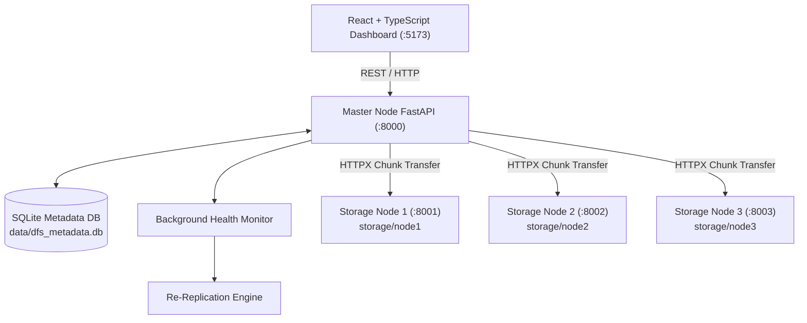

# Architecture & Implementation Guide

## 1. System Overview

The **Distributed File System with Fault Tolerance** follows a Master–Worker (Coordinator–Storage Node) architecture inspired by GFS/HDFS, adapted for REST/HTTP and local multi-process execution.

---

## 2. Core Algorithms

### 2.1 File Chunking & Reconstruction
- Files are read by the Master Node, hashed in full using SHA-256, and split into fixed-size chunks (`default_chunk_size = 1,048,576` bytes / 1 MiB, configurable via `/settings`).
- Each chunk receives a deterministic ID `<file_id>_c<index:05d>` and its own SHA-256 digest.
- During download, chunks are fetched in ascending `chunk_index` order, verified individually against their stored SHA-256, concatenated, and verified against the original file SHA-256 before returning bytes to the client.

### 2.2 Round-Robin Distribution & Distinct-Node Replication
- `RoundRobinDistributor` sorts currently `online` nodes by `node_id` and maintains a thread-safe rotating pointer.
- For each chunk, it selects `min(replication_factor, len(online_nodes))` distinct nodes starting at `pointer`, then advances `pointer` by 1.
- The first selected node is designated `is_primary = True`; the remaining nodes store replicas (`is_primary = False`).
- Duplicate placement of two copies of the same chunk on the same node is prevented both by the selection algorithm and by `UNIQUE(chunk_id, node_id)` in SQLite.
- If fewer online nodes exist than `replication_factor`, the file is marked `degraded` (`under_replicated`) rather than falsely claiming full replication.

### 2.3 Fault Tolerance & Automatic Recovery
1. **Health Monitoring:** `HealthMonitor` periodically polls every registered node's `GET /health` and `GET /stats` endpoints, updating latency, uptime, disk capacity, and `last_heartbeat`.
2. **Failure Detection:** After `node_failure_threshold` consecutive failed probes, a node is marked `offline` and a `NODE_OFFLINE` event is logged.
3. **Replica Failover on Download:** If a primary node is offline, unreachable, or returns a corrupted chunk (SHA-256 mismatch), `FileService.download_file` marks corrupted copies as `corrupted`, logs `REPLICA_FAILOVER` or `CHUNK_CORRUPTION_DETECTED`, and transparently fetches the chunk from the next healthy replica.
4. **Automatic Re-Replication:** When a node goes offline (and `auto_replicate_on_failure` is enabled), `Replicator.re_replicate_under_replicated_chunks()` scans for chunks with fewer than `replication_factor` active copies on `online` nodes, fetches a verified copy from a healthy node, and uploads it to another `online` node that does not already hold that chunk.

---

## 3. Metadata Schema (SQLite WAL)

| Table | Purpose |
|---|---|
| `storage_nodes` | Registered node IDs, URLs, online/offline status, disk capacity, latency, heartbeat |
| `files` | File ID, sanitized filename, size, original SHA-256, chunk size, total chunks, replication factor, health status |
| `chunks` | Ordered chunk IDs, parent `file_id`, `chunk_index`, byte size, chunk SHA-256 |
| `chunk_locations` | Mapping `(chunk_id, node_id)` with `is_primary`, `status` (`stored`/`corrupted`/`missing`), and `verified_at` |
| `system_events` | Audit log of uploads, downloads, node state changes, failovers, corruption alerts, and re-replications |
| `settings` | Persisted runtime configuration (`chunk_size`, `replication_factor`, `max_upload_size_mb`, `auto_replicate_on_failure`) |

---

## 4. Security & Safety Controls

- **Filename Sanitization:** Directory prefixes (`../`, `\`, `/`) and control characters are stripped before persisting metadata.
- **Chunk ID Validation:** Storage Nodes enforce `^[A-Za-z0-9_-]{1,128}$` and verify resolved paths remain strictly inside `base_dir`.
- **Atomic Chunk Writes:** Chunks are written to temporary files and moved via `os.replace` after SHA-256 verification.
- **Upload Size Limits:** Configurable `max_upload_size_mb` guard prevents unbounded memory usage.
- **No Code Execution:** Uploaded payloads are treated strictly as opaque binary streams; no shell commands or file execution are ever performed.

### Academic Prototype Limitations
- No authentication/RBAC or TLS/mTLS between Master and Storage Nodes (intended for local/lab networks).
- Uploads/downloads buffer file payloads in Master memory rather than streaming directly from client to Storage Nodes.
- Single Master Node (no Raft/consensus leader election for Master HA).
